<div align="center">

# 🎭 El Deseo de Existir — Venta de entradas

**Plataforma de ticketing con plano de butacas interactivo, reservas con vencimiento y panel de administración.**
Construida y en producción para el show 2026 de [Epifanía Dance](https://www.instagram.com/epifaniadance/) (Sala Mayor de la Facultad de Derecho, UNC — Córdoba, Argentina).

[](https://github.com/Marcovf9/gestion-entradas/actions/workflows/ci.yml)


[**🌐 Ver el sitio en vivo**](https://entradas-frontend.onrender.com) ·
[**📘 Documentación de la API (Swagger)**](https://entradas-backend.onrender.com/swagger-ui/index.html)

<sub>El sitio corre en el plan gratuito de Render: si nadie lo visitó hace un rato, la primera carga puede tardar cerca de un minuto en despertar.</sub>

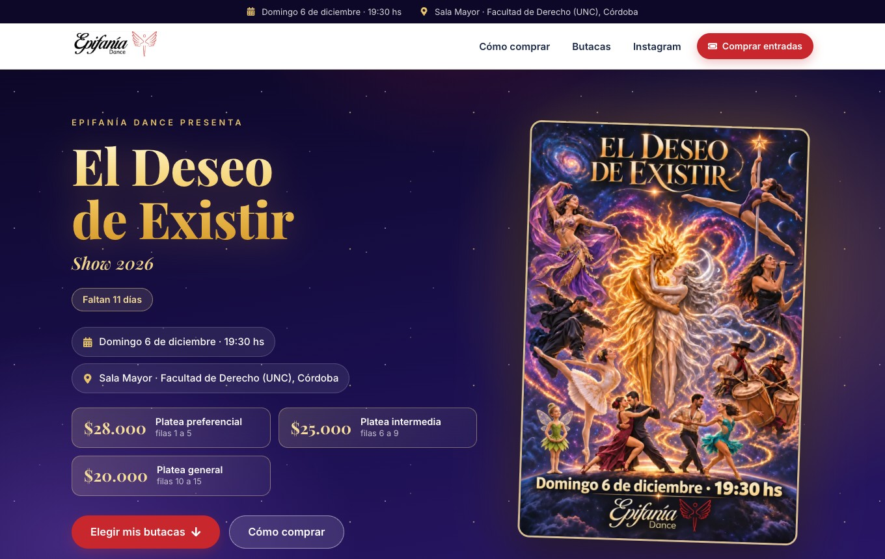

</div>

---

## ¿Qué resuelve?

El show tiene 300 butacas con tres categorías de precio y el cobro se coordina por WhatsApp. El sistema permite que **cada persona elija sus butacas en el plano de la sala**, las **reserve por 30 minutos** y avise por WhatsApp con un mensaje ya armado, mientras que **Epifanía confirma el pago desde un panel** y las butacas pasan a vendidas. Si el pago no llega, **las butacas se liberan solas**.

No integra una pasarela de pagos a propósito: el cobro lo coordina la organización directamente con cada persona. Lo que sí garantiza el sistema es que **una butaca nunca se vende dos veces**.

## Capturas

### Sitio público (mobile-first)

<table>
  <tr>
    <td align="center">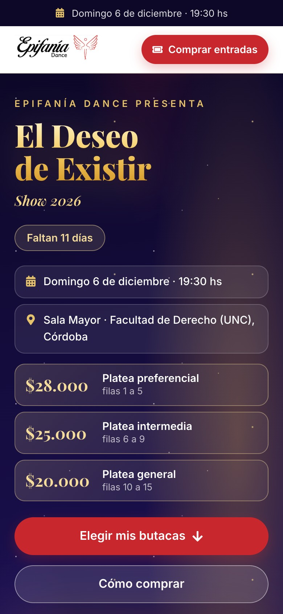<br><sub><b>Portada</b></sub></td>
    <td align="center">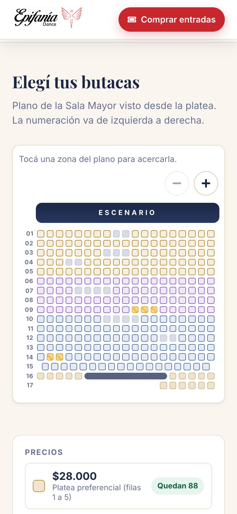<br><sub><b>Plano completo, sin deslizar</b></sub></td>
    <td align="center">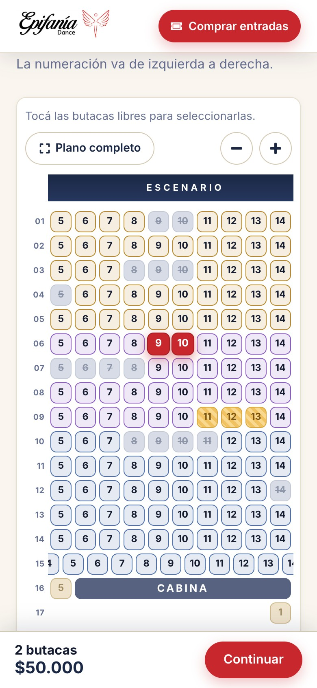<br><sub><b>Un toque acerca la zona</b></sub></td>
    <td align="center">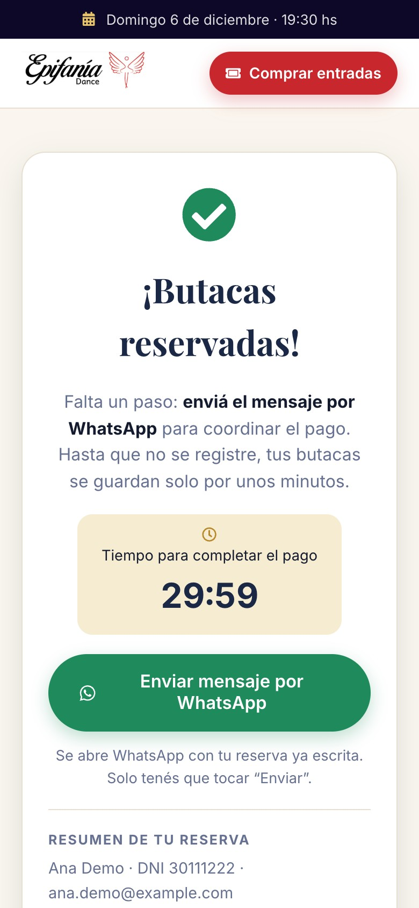<br><sub><b>Reserva con cuenta regresiva</b></sub></td>
  </tr>
</table>

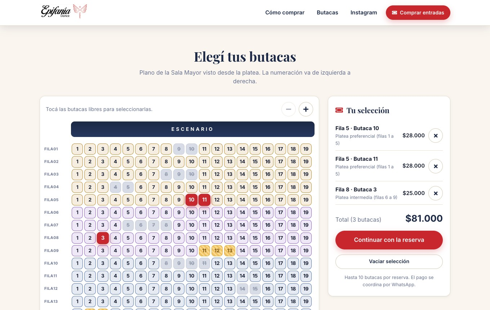

### Panel de administración

<table>
  <tr>
    <td>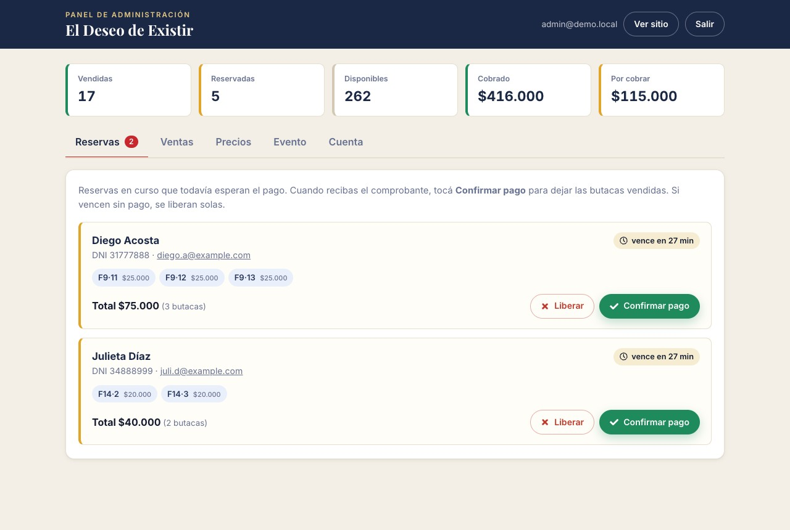<br><sub><b>Reservas</b>: agrupadas por comprador, con confirmar pago / liberar.</sub></td>
    <td>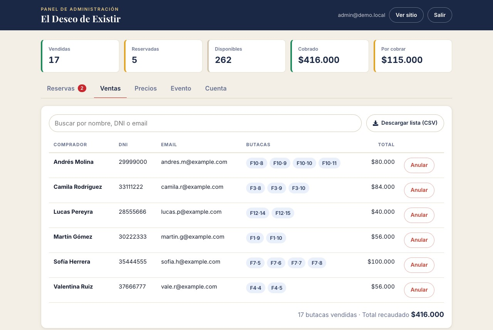<br><sub><b>Ventas</b>: búsqueda, anulación y exportación a CSV.</sub></td>
  </tr>
</table>

<details>
<summary>Más capturas: edición de precios y vista previa al compartir el link</summary>

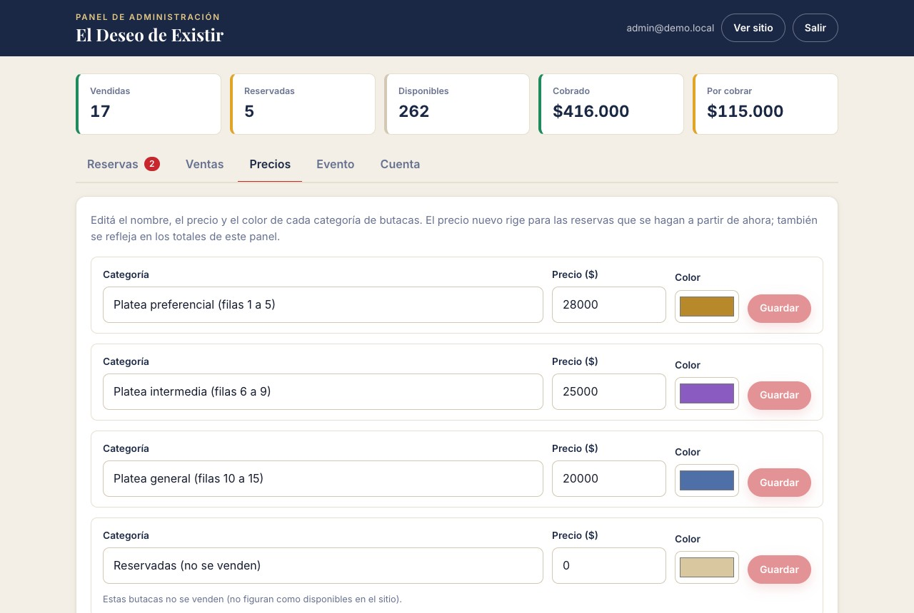

La tarjeta que se ve al compartir el link por WhatsApp, Instagram o X (Open Graph / Twitter Cards):


</details>

> Los nombres y datos de las capturas del panel son ficticios (base de demostración).

## Funcionalidades

**Para quien compra**
- Plano real de la sala (300 butacas): filas de distinto largo, una fila desplazada medio asiento y una cabina en el medio, dibujado a partir de datos y no de un layout fijo.
- Selección de hasta 10 butacas con total en vivo, categorías de precio por color y cuántas quedan de cada una.
- Reserva con validación, vencimiento de 30 minutos y mensaje de WhatsApp pre-armado.
- La pantalla de la reserva **se sincroniza sola con el servidor**: pasa a "¡Pago confirmado!" cuando el admin confirma, o avisa si se liberó.
- La disponibilidad se refresca cada 20 segundos y, si otra persona toma una butaca elegida, se quita de la selección avisando.
- En celular el plano se ve completo de entrada y se acerca al tocar; accesible por teclado y con etiquetas para lectores de pantalla.

**Para quien administra** (`/#/admin`)
- Login con JWT, cambio de contraseña obligatorio la primera vez.
- Estadísticas: vendidas, reservadas, disponibles, cobrado y por cobrar.
- Confirmar pago o liberar **por grupo de butacas** (una reserva de 4 butacas es una sola tarjeta), anular ventas, buscar y exportar la lista de asistentes a CSV.
- Editar precios, nombres y colores de las categorías, y los datos del evento (fecha, hora, lugar) sin tocar código.

## Decisiones técnicas que vale la pena mirar

| Tema | Qué hice | Por qué |
| --- | --- | --- |
| **Nunca vender dos veces una butaca** | Lock pesimista (`SELECT … FOR UPDATE`) sobre las butacas pedidas dentro de la transacción de reserva. | Leer y después actualizar no alcanza bajo concurrencia. Hay un test que lanza dos reservas simultáneas de la misma butaca desde dos hilos y verifica que solo una gana. |
| **Reservas que vencen** | Job programado cada 60 s + chequeo defensivo dentro de la propia reserva. | Una butaca vencida se libera aunque el job no haya corrido todavía. |
| **Bug de Spring AOP (auto-invocación)** | Un método `@Transactional(REQUIRES_NEW)` llamado desde la misma clase no pasa por el proxy y seguía corriendo en una transacción *read-only*. | Lo detecté probando contra Postgres real (H2 no lo reproducía) y por eso los tests de integración corren contra Postgres. Quedó cubierto con tests de regresión. |
| **Plano guiado por datos** | Cada butaca guarda su posición (`pos_x`, en medios asientos) y la cabina es un elemento del mapa. | Un cambio de sala o de evento no requiere tocar el frontend. Un test migra desde cero y verifica la geometría (butacas por fila, que nada se pise, posición de la cabina). |
| **Migraciones versionadas** | Flyway (V1–V4). Los cambios de datos en producción van como migración nueva, nunca editando una anterior. | La V4 (cambio de precios y categoría nueva) se probó desde cero y sobre una base con ventas existentes, y es tolerante a bases sin datos. |
| **Zona horaria** | Se fija `America/Argentina/Cordoba` y las respuestas incluyen `segundosRestantes`. | Los vencimientos son `LocalDateTime` sin zona y el servidor en la nube corre en UTC: sin esto, la cuenta regresiva salía corrida 3 horas. |
| **Seguridad** | JWT stateless, contraseñas con BCrypt, validación con Bean Validation, CORS por variable de entorno, rate limit por IP en la reserva y admin inicial por variables de entorno. | Superficie pública mínima: solo lectura del plano y crear reservas; todo lo demás exige token. |
| **Mobile-first real** | Vista completa del plano con butacas diminutas y "toque para acercar", estado de la reserva sincronizado, sin librerías de UI. | Una captura del sitio en un celular mostraba que se veían 13 de 19 columnas: se rediseñó el plano en base a eso. |
| **Infra como código** | Un único `render.yaml` (Blueprint) crea la base, la API (Docker) y el sitio estático, y cablea las credenciales de la base. | Recrear todo desde cero lleva minutos y no hay secretos copiados a mano. |

## Arquitectura

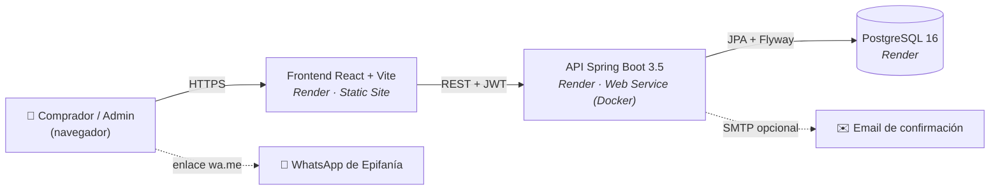

### Flujo de una compra

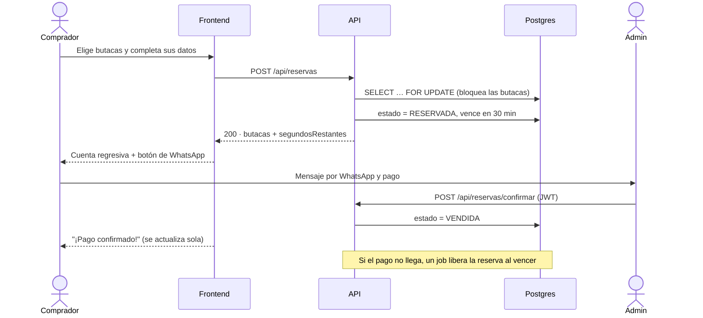

### Modelo de datos

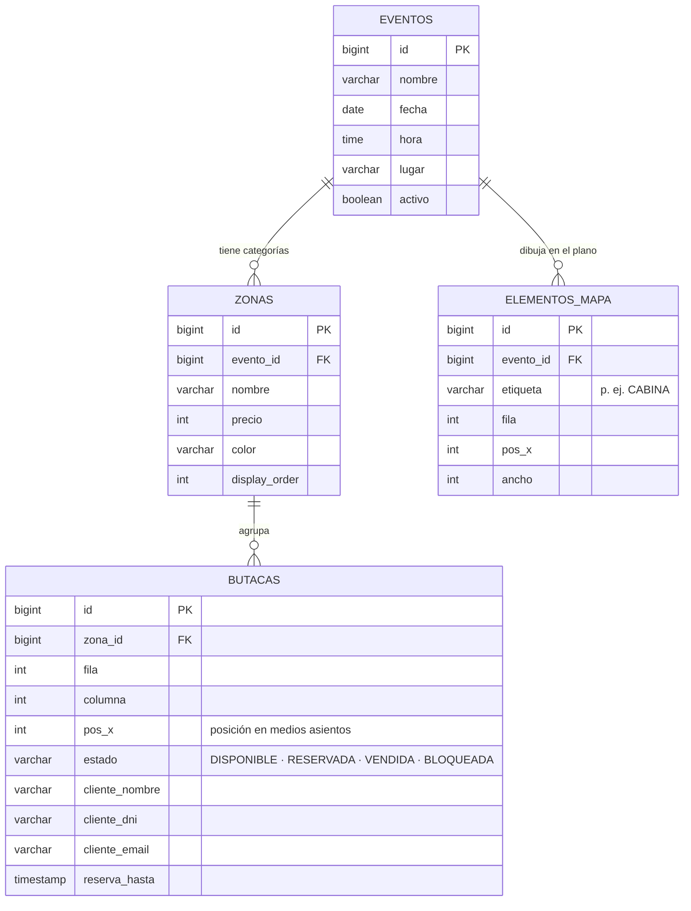

## API

La documentación interactiva está en [`/swagger-ui/index.html`](https://entradas-backend.onrender.com/swagger-ui/index.html).

| Método y ruta | Acceso | Descripción |
| --- | --- | --- |
| `GET /api/eventos` | público | Eventos activos |
| `GET /api/eventos/{id}/zonas` · `/butacas` · `/elementos` | público | Categorías, butacas con su estado y elementos del plano |
| `POST /api/reservas` | público · rate limit | Reserva butacas (lock + vencimiento) |
| `POST /api/auth/login` | público | Devuelve un JWT |
| `GET /api/reservas/activas?eventoId=` · `/vendidas?eventoId=` | admin | Reservas pendientes y ventas, con datos del comprador |
| `POST /api/reservas/confirmar` · `/liberar` | admin | Confirmar pago o liberar/anular un grupo de butacas |
| `POST /api/auth/cambiar-password` | admin | Cambio de contraseña |
| `PUT /api/admin/eventos/{id}` · `/api/admin/zonas/{id}` | admin | Editar evento y categorías |
| `GET /api/health` | público | Health check |

## Stack

- **Backend:** Java 21, Spring Boot 3.5 (Web, Data JPA, Security, Validation, Mail), JJWT, Flyway, springdoc-openapi, Lombok.
- **Base de datos:** PostgreSQL 16.
- **Frontend:** React 18, Vite 5, axios. CSS propio, sin librerías de UI.
- **Calidad:** 26 tests de integración contra Postgres real (JUnit 5 + MockMvc) y GitHub Actions con un servicio de Postgres.
- **Deploy:** Render (Blueprint) con Docker multi-stage para la API.

## Estructura del repositorio

```
├── backend/                 API Spring Boot
│   └── src/main
│       ├── java/…/entradas  controllers · services · repositories · models · dto · security · config · exception
│       └── resources/db/migration   V1…V4 (Flyway)
├── frontend/                Sitio React + Vite
│   └── src                  components/{public,admin,ui} · hooks · services · utils · styles
├── docs/screenshots/        Capturas usadas en este README
├── docker-compose.yml       Postgres para desarrollo local
├── render.yaml              Infraestructura: base + API + sitio estático
└── .github/workflows/ci.yml Tests del backend, build del frontend, build de la imagen Docker
```

## Cómo correrlo en tu máquina

Requisitos: Java 21, Node 20+ y Docker (o un Postgres propio).

```bash
# 1) Base de datos (Postgres 16 con los datos que espera la app)
docker compose up -d

# 2) Backend en http://localhost:8080  (Flyway crea las tablas y carga el evento)
cd backend
ADMIN_DEFAULT_EMAIL=admin@example.com ADMIN_DEFAULT_PASSWORD=cambiame-ahora ./mvnw spring-boot:run

# 3) Frontend en http://localhost:5173
cd ../frontend
npm install
npm run dev
```

- Sitio de venta: `http://localhost:5173` · Administración: `http://localhost:5173/#/admin`.
- `ADMIN_DEFAULT_*` solo se usan si todavía no existe ningún admin, y el panel obliga a cambiar la contraseña al primer ingreso.

### Tests

Los tests corren contra Postgres real y **limpian la base** que usen (uno de ellos migra desde cero), así que necesitan una base aparte:

```bash
docker compose exec db createdb -U postgres entradas_test
cd backend && ./mvnw test
```

### Variables de entorno

| Variable | Dónde | Para qué | Default |
| --- | --- | --- | --- |
| `SPRING_DATASOURCE_URL` *o* `SPRING_DATASOURCE_HOST` / `_PORT` / `_DBNAME` | backend | Conexión a Postgres | `localhost:5432/entradas` |
| `SPRING_DATASOURCE_USERNAME` / `_PASSWORD` | backend | Credenciales de la base | `postgres` / `postgres` |
| `JWT_SECRET` | backend | Clave de firma de los tokens (usar un valor largo y aleatorio) | valor de desarrollo |
| `ADMIN_DEFAULT_EMAIL` / `ADMIN_DEFAULT_PASSWORD` | backend | Admin inicial (solo si no hay ninguno) | — |
| `CORS_ALLOWED_ORIGINS` | backend | Orígenes permitidos, separados por coma | `http://localhost:5173` |
| `MAIL_HOST` / `MAIL_PORT` / `MAIL_USERNAME` / `MAIL_PASSWORD` | backend | SMTP para los emails de confirmación (opcional) | desactivado |
| `VITE_API_URL` | frontend | URL del backend, con `/api` | `http://localhost:8080/api` |
| `VITE_WHATSAPP_PHONE` | frontend | Número que recibe las reservas (formato internacional) | número de la organización |
| `VITE_INSTAGRAM_USER` | frontend | Usuario de Instagram del pie de página | `epifaniadance` |

## Despliegue

`render.yaml` es un [Blueprint de Render](https://render.com/docs/blueprint-spec): en **New → Blueprint** se conecta el repo y Render crea la base, la API y el sitio, cableando host, usuario y contraseña de la base sin copiar ningún secreto. Solo hay que cargar `JWT_SECRET` y el admin inicial.

Flujo de ramas: `feature/*` → PR a `develop` → PR de `develop` a `produccion`. **Render despliega solo desde `produccion`**, y el CI corre en cada push y en los PR hacia `develop` y `produccion`.

## Limitaciones y próximos pasos

- **Sin pasarela de pago:** es una decisión de producto (el cobro se coordina por WhatsApp). Integrar Mercado Pago permitiría confirmar pagos automáticamente.
- **Frontend sin tests automáticos:** hoy el CI solo verifica que compile. Lo siguiente sería sumar Vitest para la lógica y Playwright para el flujo de compra.
- **Rate limit en memoria:** alcanza para una instancia; con varias habría que moverlo a Redis o al borde.
- **Un solo administrador:** suficiente para este caso; un modelo de usuarios y roles sería el paso natural.
- **Entradas digitales:** hoy se verifica por DNI en la puerta; un código QR por reserva agilizaría el ingreso.

## Autoría y uso

Desarrollado por **Marco Vergara** ([@Marcovf9](https://github.com/Marcovf9)) como proyecto real para Epifanía Dance. El código se publica con fines de portfolio; el afiche, el logo y el nombre del espectáculo pertenecen a Epifanía Dance.

---

<details>
<summary><b>🇬🇧 English summary</b></summary>

**El Deseo de Existir** is a production ticketing platform I built for a live dance show in Córdoba, Argentina: an interactive seat map for a 300-seat venue, 30-minute seat holds, WhatsApp-based payment coordination, and an admin panel to confirm payments and manage sales.

- **Back end:** Java 21, Spring Boot 3.5, Spring Security with stateless JWT, PostgreSQL, Flyway migrations, OpenAPI docs.
- **Front end:** React 18 + Vite, mobile-first, no UI library; the seat map is rendered from data (per-seat positions), so a new venue layout needs no front-end changes.
- **Correctness:** pessimistic row locks guarantee a seat is never sold twice (covered by a two-thread concurrency test); expired holds are released by a scheduled job; 26 integration tests run against a real PostgreSQL in CI.
- **Ops:** a single Render Blueprint provisions the database, the Dockerized API and the static site; `develop` → `produccion` branch flow with CI on every push.

Live demo: https://entradas-frontend.onrender.com · API docs: https://entradas-backend.onrender.com/swagger-ui/index.html

</details>
